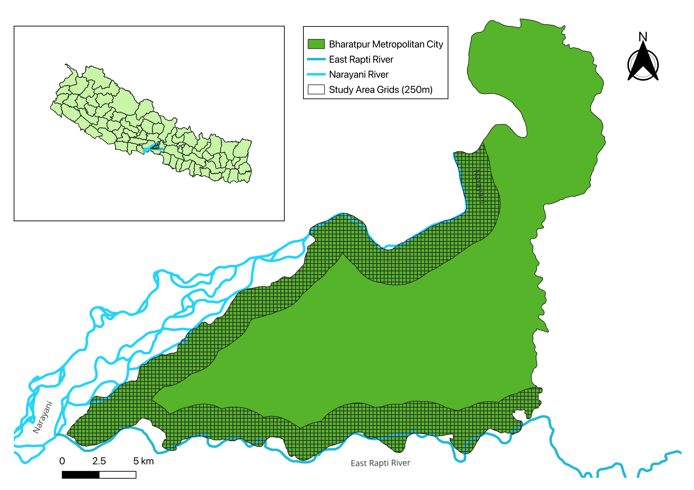
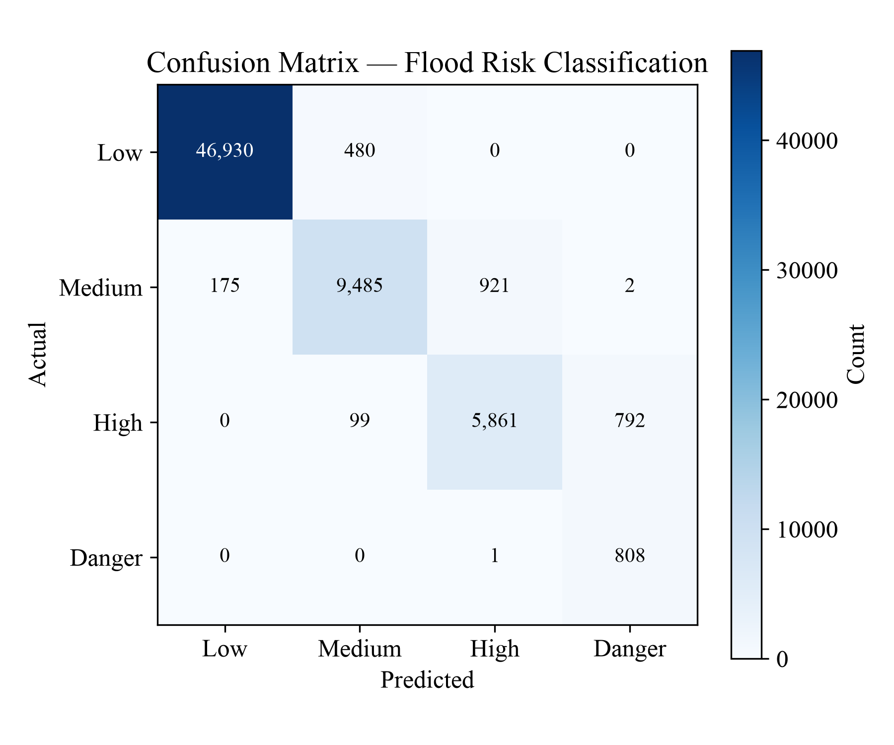
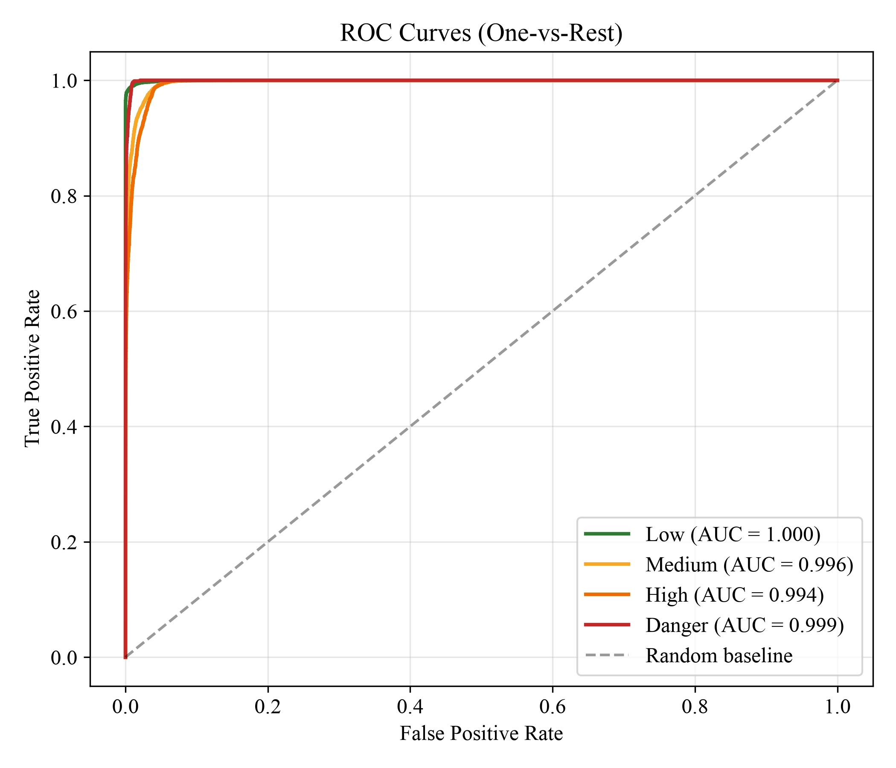

# Flood Risk Monitoring System

Grid-wise flood risk classification for Bharatpur Metropolitan City, Nepal, combining
GIS-derived terrain features with live hydro-meteorological conditions through a machine
learning classifier, served as an interactive web dashboard.

Nepal's flood monitoring relies on a sparse network of rainfall and river gauge stations
that report conditions at a handful of points. That tells you the river is high; it does
not tell you which neighbourhoods are at risk. This system divides the municipality into
**2,434 valid 250m grid cells**, each carrying its own terrain profile, and scores every
cell against current rainfall and river levels to produce a map of where the risk actually
is.



---

## What it does

- Classifies every 250m grid cell into **Low / Medium / High / Danger** from 14 features.
- Pulls **live rainfall and river-level readings** from the BIPAD Portal, or accepts manual
  entry for simulation and what-if analysis.
- Resolves each grid to its **own assigned river gauge**, so the Narayani side and the East
  Rapti side are evaluated against different water levels in the same request.
- Renders results on an interactive Leaflet map with a dissolved affected-area layer,
  ward-level reports, per-grid contributing factors, and model comparison.
- Logs rainfall, river level, forecasts, predictions and risk results to a history database.

---

## Results

Final model performance on the fully held-out 2026 test set (87,624 rows):

| Model                    | Accuracy | Macro F1 | Danger Precision | Danger Recall |
| ------------------------ | -------- | -------- | ---------------- | ------------- |
| Logistic Regression      | 0.890    | 0.700    | 0.30             | 0.55          |
| Random Forest            | 0.922    | 0.778    | 0.291            | 0.974         |
| XGBoost (default)        | 0.967    | 0.882    | 0.574            | 0.959         |
| **XGBoost (tuned)** ✅   | **0.969**| **0.897**| **0.647**        | **0.940**     |

**XGBoost with a calibrated Danger-class threshold (0.594)** is the deployed model. The
calibration trades a small amount of Danger recall (0.959 → 0.940) for a large precision
gain (0.574 → 0.647), on the reasoning that a missed flood is worse than a false alarm but
an alert nobody trusts is worse than both.

<p align="center">
  
  
</p>

Performance holds across both river basins:

| River    | Test Rows | Accuracy | Macro F1 | Danger Precision | Danger Recall |
| -------- | --------- | -------- | -------- | ---------------- | ------------- |
| Narayani | 46,728    | 0.964    | 0.874    | 0.517            | 0.999         |
| Rapti    | 40,896    | 0.969    | 0.904    | 0.763            | 0.880         |

---

## Architecture

```
┌──────────────┐   REST    ┌──────────────┐   joblib   ┌─────────────────┐
│   React +    │ ────────► │   FastAPI    │ ─────────► │ XGBoost (tuned) │
│  Leaflet.js  │ ◄──────── │   backend    │ ◄───────── │  + LogReg, RF   │
└──────────────┘  GeoJSON  └──────┬───────┘            └─────────────────┘
                                  │
                   ┌──────────────┼──────────────┐
                   ▼              ▼              ▼
            ┌────────────┐ ┌────────────┐ ┌────────────┐
            │ Static grid│ │   BIPAD    │ │  History   │
            │  GeoJSON   │ │   Portal   │ │ DB (SQLite │
            │ 2,434 cells│ │ live feed  │ │  / MySQL)  │
            └────────────┘ └────────────┘ └────────────┘
```

A prediction request names a grid and the current conditions. The feature builder loads the
grid's static terrain properties, resolves its assigned river station, converts the raw
water level into a normalized score against that station's warning and danger thresholds,
and hands a 14-feature row to the model. Where no gauge or threshold can be resolved, a
documented fallback score of 0.3 is applied and **surfaced in the response** rather than
silently defaulted.

---

## Repository layout

| Path                  | Contents                                                                 |
| --------------------- | ------------------------------------------------------------------------ |
| `backend/`            | FastAPI service, ML inference, feature engineering, database layer        |
| `frontend/`           | React + Vite + Leaflet dashboard                                          |
| `data-pipeline/`      | Data acquisition, feature engineering, training and validation scripts    |
| `gis/`                | QGIS project files and study-area vector layers                           |
| `docs/`               | API reference, ER diagram, model evaluation figures                       |

---

## Quick start

### Backend

```bash
cd backend
python -m venv .venv && source .venv/bin/activate
pip install -r requirements.txt
cp .env.example .env            # optional: SQLite is the default
uvicorn app.main:app --reload --port 8000
```

API docs at <http://localhost:8000/docs>.

> **Note:** `models/model_random_forest.joblib` (384MB) is excluded from version control.
> The backend runs fine without it — the Random Forest option simply reports as unavailable
> in `/api/models`. Regenerate it with `data-pipeline/models/` if you want the full
> four-model comparison.

### Frontend

```bash
cd frontend
nvm use 18
npm install
cp .env.example .env            # VITE_API_BASE_URL=http://localhost:8000
npm run dev
```

Dashboard at <http://localhost:5173>.

### Docker

```bash
cd backend  && docker compose up --build       # API on :8000
cd frontend && docker compose up --build       # dashboard on :3000
```

The backend Compose file also carries a MySQL service behind a `mysql` profile
(`docker compose --profile mysql up`) for the relational target; SQLite is the default and
needs no extra driver.

---

## API

| Method | Endpoint                        | Purpose                                            |
| ------ | ------------------------------- | -------------------------------------------------- |
| `GET`  | `/api/grids`                    | All 2,434 grid cells as GeoJSON                     |
| `GET`  | `/api/grids/{grid_id}`          | One grid with full static properties                |
| `GET`  | `/api/grids/filter`             | Filter by risk class, LULC, elevation, distance     |
| `GET`  | `/api/risk/static`              | Static susceptibility layer                         |
| `POST` | `/api/predict`                  | Classify one grid under given conditions            |
| `POST` | `/api/predict/compare`          | Same input scored by every available model          |
| `GET`  | `/api/risk-map`                 | Batch-score all grids, returns classified GeoJSON   |
| `GET`  | `/api/risk-map/affected-area`   | Dissolved High/Danger polygon                       |
| `GET`  | `/api/conditions/live`          | Current BIPAD rainfall and river readings           |
| `GET`  | `/api/conditions/forecast`      | Forecast-mode conditions                            |
| `GET`  | `/api/wards/risk-report`        | Per-ward aggregated risk summary                    |
| `GET`  | `/api/layers/rivers`            | Narayani and East Rapti river polygons              |
| `GET`  | `/api/layers/wards`             | Ward boundary layer                                 |
| `GET`  | `/api/models`                   | Available models and their evaluation metadata      |
| `GET`  | `/api/history/*`                | Logged rainfall, river level, forecasts, predictions|
| `GET`  | `/api/summary`                  | Dataset-level summary statistics                    |

Full request and response shapes are in [`docs/API_REFERENCE.md`](docs/API_REFERENCE.md).

---

## Methodology

### Static susceptibility

Each grid's terrain susceptibility is a weighted combination of six normalized scores:

```
static_susceptibility = 0.30·river_distance + 0.25·elevation + 0.15·slope
                      + 0.15·lulc + 0.10·flood_history + 0.05·flow_accumulation
```

### Dynamic hazard

```
dynamic_hazard = max(0.70·rainfall_score + 0.30·river_level_score, river_level_score)
```

The outer maximum means a severe river condition alone cannot be diluted by low local
rainfall — an already-elevated river is dangerous whether or not it is currently raining
over your grid.

### Combined risk

```
final_risk = static_susceptibility × (0.2 + 0.8 × dynamic_hazard)
```

The 0.2 floor keeps a grid's underlying terrain vulnerability contributing a baseline risk
even under calm conditions. Risk classes come from fixed percentile thresholds computed on
the observed-only distribution.

### Features

Fourteen features per prediction: elevation, slope, distance to the Narayani, distance to
the Rapti, nearest river distance, nearest major river encoding, within-2km flags for both
rivers, land use encoding, historical flood evidence, flow accumulation score, 24-hour
rainfall, a normalized rainfall score (saturating at 140mm), and a normalized river level
score.

Four sub-hourly rainfall columns and the raw water level were **deliberately excluded**.
The sub-hourly columns were silently zero across the entire historical reconstruction —
CHIRPS provides only daily values — and keeping them would have taught the model a false
"no rain" signal on major historical flood days. Raw water level was 38% missing and
redundant with the derived score once the fallback convention was in place.

### Training split

Chronological, not random: training through 2024, validation on 2025, testing from 2026
onward. A random split would have let temporally adjacent readings leak across the boundary
and inflated reported performance.

---

## Data pipeline

```
acquisition/  →  pipeline/00 … 10  →  models/  →  validation/
```

| Stage | Script                                      | Output                                     |
| ----- | ------------------------------------------- | ------------------------------------------ |
| 00    | `00_assign_stations_to_grid.py`             | Grid → rainfall/river station assignment   |
| 01    | `01_flood_evidence_and_static_finalize.py`  | Static dataset with flood evidence         |
| 01b   | `01b_recalibrate_risk_thresholds.py`        | Jenks natural-breaks class thresholds      |
| 02    | `02_rainfall_event_selection.py`            | Rainfall event windows                     |
| 03    | `03_build_ml_training_dataset.py`           | Observed-data training rows                |
| 04    | `04_train_models*.py`                       | LogReg, Random Forest, XGBoost             |
| 05    | `05_flow_accumulation_extraction.py`        | D8 flow accumulation (pysheds)             |
| 06    | `06_chirps_glofas_historical_backfill.py`   | 1993–2020 reconstruction                   |
| 07–08 | DesInventar expansion, evidence override    | Historical flood labels                    |
| 09    | `09_build_historical_grid_training_rows.py` | Per-grid historical rows                   |
| 10    | `10_merge_and_finalize_training_data.py`    | Final 2.59M-row training set               |

See [`data-pipeline/README.md`](data-pipeline/README.md) for data sources, acquisition
instructions and what is and is not committed.

---

## Data sources

| Source                  | Used for                                            |
| ----------------------- | --------------------------------------------------- |
| Copernicus DEM GLO-30   | Elevation, slope, D8 flow accumulation              |
| ESA WorldCover 2021     | Land use / land cover classification                |
| BIPAD Portal (NDRRMA)   | Live rainfall, river levels, historical incidents   |
| DHM Nepal               | Rainfall and river gauge station network            |
| CHIRPS                  | Daily satellite rainfall, 1993–2020 reconstruction  |
| GloFAS-ERA5             | River discharge reanalysis, 1993–2020               |
| Sentinel-1 SAR          | Flood extent validation (2024-09-28 event)          |

Raw rasters and the multi-gigabyte derived datasets are not committed. Acquisition scripts
for each source are in `data-pipeline/acquisition/`.

---

## Engineering notes

Things that went wrong and were fixed — kept here because the fixes are the interesting part:

- **Evaluation leakage.** The Danger threshold was initially tuned on the same test set used
  for final reporting. Corrected to calibrate on all real observed data from 2021–2025
  (797,864 rows, 16,491 Danger examples), explicitly excluding both the 2026 test set and
  the CHIRPS/GloFAS reconstruction.
- **Random Forest at 8.46GB.** Trained with unbounded tree depth, large enough to risk an
  out-of-memory failure on load. Retrained at `max_depth=18`, `min_samples_leaf=5`,
  `max_leaf_nodes=5000` — file dropped to 384MB *and* measured performance improved,
  confirming the unconstrained trees had overfit.
- **River-fairness measurement bug.** Per-river evaluation initially compared the two basins
  incorrectly; the corrected stratified results are the table above.
- **Flat-scoring river segment.** An early river-level scoring function assigned identical
  scores to materially different river stages. Replaced with a continuous ramp against each
  station's warning and danger thresholds.
- **scikit-learn version pinning.** The models pickle under 1.9.0; loading them under 1.7.x
  fails with `'LogisticRegression' object has no attribute 'multi_class'`. Pinned in
  `requirements.txt` with the reason written down.

---

## Tech stack

**Backend** — Python 3.11+, FastAPI, scikit-learn, XGBoost, GeoPandas, Shapely, SQLAlchemy,
Alembic, SQLite / MySQL
**Frontend** — React 18, Vite, Leaflet, react-leaflet, MUI, Recharts
**Geospatial** — QGIS, Rasterio, pysheds, mapclassify, Google Earth Engine
**Infrastructure** — Docker, Docker Compose, Nginx

---

## License

MIT — see [LICENSE](LICENSE).

Data products remain under their original licenses: ESA WorldCover (CC BY 4.0), Copernicus
DEM (free, full and open), CHIRPS (public domain), GloFAS/ERA5 (Copernicus license).
